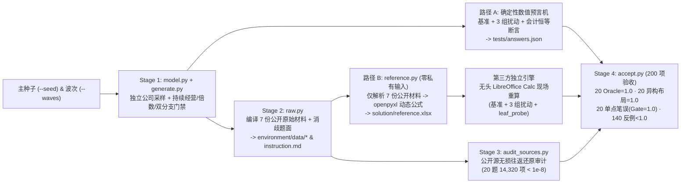

# DCFEval：高难度、完全可验证的从零构建 DCF 估值评测集

`DCFEval` 是一个面向 LLM Agent 的高难度端到端财务建模评测集，严格接入 [Harbor](https://github.com/laude-institute/harbor)（`schema_version = "1.4"`）标准任务格式。仓库包含 **20 道完全原创、零人工介入自动生成的 DCF 建模题目**（`DCFEval/dcf-01-saas` 至 `DCFEval/dcf-20-returns`），绝不包含任何外网原题。

每道题均要求 Agent 在**空白工作簿（无模板、无公式骨架、无已有结果）**环境下，仅依据 `/work/data/` 中的 **7 份原始形态财务与经营材料**，从零搭建 FY2025 历史合并报表、FY2026–2030 预测三大报表与自由现金流（FCFF）估值模型，并交付纯动态公式驱动的 `/work/output.xlsx`。

> **深度技术规范**：评分标准演进（v1 → v3 从业者四支柱重构）与双独立路径验证细节见 [`docs/SCORING_AND_REFERENCE_PIPELINE.md`](docs/SCORING_AND_REFERENCE_PIPELINE.md)；解题轨迹归档规范见 [`trajectories/README.md`](trajectories/README.md)。

---

## 目录导航

- [第一章：评测集构造](#第一章评测集构造)
  - [1.1 题目定位、约束达标与 20 题总览](#11-题目定位约束达标与-20-题总览)
  - [1.2 造题方案解读（参考解生产 · 零歧义保障 · Harbor 自动化组装）](#12-造题方案解读参考解生产--零歧义保障--harbor-自动化组装)
  - [1.3 从业者四支柱评分标准（v3.0）与底层防贴死数门控](#13-从业者四支柱评分标准v30与底层防贴死数门控)
- [第二章：评估落地](#第二章评估落地)
  - [2.1 落地规范核对与 Oracle 20/20 全量验收（200 项正反例）](#21-落地规范核对与-oracle-2020-全量验收200-项正反例)
  - [2.2 `harbor run` 一键复现与多模型评测命令](#22-harbor-run-一键复现与多模型评测命令)
  - [2.3 最新 20 题多模型实测分数总表（均分 · 耗时 · Token · 轮次）](#23-最新-20-题多模型实测分数总表均分--耗时--token--轮次)
  - [2.4 失败 Case 归纳分析与全量解题轨迹推送规范](#24-失败-case-归纳分析与全量解题轨迹推送规范)
- [第三章：交付物清单与仓库目录结构](#第三章交付物清单与仓库目录结构)

---

# 第一章：评测集构造

## 1.1 题目定位、约束达标与 20 题总览

| 构造维度 | 设计落地与达标情况 |
|---|---|
| **题目类型与起点** | 全部 20 题均要求从**空白工作簿**开始构建，`/work/data/` 仅提供 7 份原始 CSV/Markdown 业务与财务材料，**零 `.xlsx` 模板、零公式骨架、零预置 DCF 结果** |
| **题目规模与覆盖** | **20 道独立题目**（10 种差异化行业经营递推机制 × 2 波次），4 种 `{永续增长 / 退出 EBITDA} × {年中 / 年末折现}` 估值象限严格均衡（各 **5 题**） |
| **可 Scaling 与零人工** | 100% 纯 Python + 开源 `openpyxl` 自动生成流水线 [`dcf_benchmark/build_all.py`](dcf_benchmark/build_all.py)，更改 `--seed` 或 `--waves` 即可零人工批量扩展至任意题量 |
| **原创性与防污染** | 全部公司主体、两地关账、经营驱动、预算、同行 Beta 与期权批次均按确定性种子合成生成，**绝无外网原题或公开财报原题泄露** |
| **Harbor 题目位置** | 统一存放于仓库根目录 [`DCFEval/`](DCFEval/)，每题均含 `instruction.md`、`task.toml`、`environment/`、`solution/`、`tests/`（含 `test.sh`） |

### 最新 20 题总览与估值合理性核查表（Seed = 2026，Waves = 2，详见 [`results/manifest.json`](results/manifest.json)）

| 任务 ID | 公司主体 | 行业经营机制 | 终值方法 | FCFF 折现 | FY25 营收 (m) | WACC | EV (EUR m) | 每股内在价值 (EUR) | PV(TV)/EV | EV/FY25 EBITDA |
|---|---|---|---|---|---:|---:|---:|---:|---:|---:|
| [`dcf-01-saas`](DCFEval/dcf-01-saas/instruction.md) | SpruceCollab (云杉协作) | 订阅软件：流失、年中新签与均值扩容 | perpetuity | midyear | 105.1 | 8.30% | 623.71 | **50.42** | 77.0% | 13.1x |
| [`dcf-02-foundry`](DCFEval/dcf-02-foundry/instruction.md) | Elmbridge Semi (榆桥微芯) | 晶圆代工：产能滚动、需求上限与良率 | exit EBITDA | midyear | 215.1 | 8.70% | 882.02 | **63.43** | 70.1% | 11.5x |
| [`dcf-03-orders`](DCFEval/dcf-03-orders/instruction.md) | Starport Machinery (星浦机床) | 装备制造：期初在手订单与新签分期履约 | perpetuity | year-end | 113.1 | 7.35% | 373.88 | **22.46** | 75.4% | 10.9x |
| [`dcf-04-storage`](DCFEval/dcf-04-storage/instruction.md) | Ninggang ColdChain (宁港冷仓) | 仓储出租：退租、总库容上限与半年入驻 | exit EBITDA | year-end | 219.5 | 8.09% | 619.52 | **68.59** | 69.5% | 7.5x |
| [`dcf-05-fleet`](DCFEval/dcf-05-fleet/instruction.md) | RiverRidge Fleet (川岭器租) | 设备租赁：年初退役、年中投放与利用率 | perpetuity | midyear | 193.8 | 8.64% | 964.53 | **75.06** | 72.6% | 11.3x |
| [`dcf-06-license`](DCFEval/dcf-06-license/instruction.md) | ClearRiver CAD (晴川图软) | 许可合同：续签服务费与一次性签约费 | exit EBITDA | midyear | 140.0 | 9.26% | 530.88 | **42.05** | 70.3% | 8.8x |
| [`dcf-07-mine`](DCFEval/dcf-07-mine/instruction.md) | StoneCourt Copper (石庭铜业) | 矿业开采：储量发现、开采上限与回收率 | perpetuity | year-end | 144.2 | 8.27% | 463.92 | **27.50** | 67.1% | 6.8x |
| [`dcf-08-retail`](DCFEval/dcf-08-retail/instruction.md) | Platform Books (月台书铺) | 连锁零售：老店关停与新店首年爬坡 | exit EBITDA | year-end | 113.8 | 9.48% | 415.17 | **24.30** | 74.8% | 10.3x |
| [`dcf-09-royalty`](DCFEval/dcf-09-royalty/instruction.md) | SeaChord Audio (海弦音频) | 特许权：分档费率、超额折扣与最低保底 | perpetuity | midyear | 173.9 | 10.52% | 650.12 | **56.57** | 72.6% | 10.1x |
| [`dcf-10-returns`](DCFEval/dcf-10-returns/instruction.md) | SwiftBoat Care (凌舟维保) | 售后服务：保修到期、新签与索赔抵扣 | exit EBITDA | midyear | 144.0 | 6.73% | 557.18 | **42.54** | 67.4% | 9.4x |
| [`dcf-11-saas`](DCFEval/dcf-11-saas/instruction.md) | BambooCloud Ops (竹序算务) | 订阅软件：流失、年中新签与均值扩容 | exit EBITDA | year-end | 182.9 | 8.17% | 825.64 | **74.49** | 68.3% | 10.1x |
| [`dcf-12-foundry`](DCFEval/dcf-12-foundry/instruction.md) | HarborCreek Fab (泊川晶圆) | 晶圆代工：产能滚动、需求上限与良率 | perpetuity | year-end | 216.8 | 8.34% | 963.64 | **81.39** | 75.4% | 11.0x |
| [`dcf-13-orders`](DCFEval/dcf-13-orders/instruction.md) | Langstone Pumps (朗石泵业) | 装备制造：期初在手订单与新签分期履约 | exit EBITDA | midyear | 142.3 | 9.35% | 510.76 | **28.65** | 63.1% | 8.4x |
| [`dcf-14-storage`](DCFEval/dcf-14-storage/instruction.md) | ReedBay Thermal (芦湾恒温) | 仓储出租：退租、总库容上限与半年入驻 | perpetuity | midyear | 180.1 | 7.63% | 648.20 | **51.17** | 70.2% | 10.5x |
| [`dcf-15-fleet`](DCFEval/dcf-15-fleet/instruction.md) | Greenfield Equip (青浦工装) | 设备租赁：年初退役、年中投放与利用率 | exit EBITDA | year-end | 163.2 | 9.09% | 717.88 | **42.55** | 71.2% | 9.5x |
| [`dcf-16-license`](DCFEval/dcf-16-license/instruction.md) | Shoreline Design (岸禾设计) | 许可合同：续签服务费与一次性签约费 | perpetuity | year-end | 209.0 | 7.23% | 1,022.67 | **58.64** | 76.3% | 11.4x |
| [`dcf-17-mine`](DCFEval/dcf-17-mine/instruction.md) | RidgeSpring Zinc (岭泉锌业) | 矿业开采：储量发现、开采上限与回收率 | exit EBITDA | midyear | 130.8 | 8.07% | 377.36 | **37.65** | 57.2% | 7.0x |
| [`dcf-18-retail`](DCFEval/dcf-18-retail/instruction.md) | EastIsle Home (东屿家居) | 连锁零售：老店关停与新店首年爬坡 | perpetuity | midyear | 208.4 | 8.08% | 1,079.01 | **61.51** | 78.0% | 12.4x |
| [`dcf-19-royalty`](DCFEval/dcf-19-royalty/instruction.md) | SpringStone Media (泉石影像) | 特许权：分档费率、超额折扣与最低保底 | exit EBITDA | year-end | 100.6 | 9.75% | 516.71 | **34.93** | 75.9% | 14.0x |
| [`dcf-20-returns`](DCFEval/dcf-20-returns/instruction.md) | SilverDock Service (银栈售服) | 售后服务：保修到期、新签与索赔抵扣 | perpetuity | year-end | 141.7 | 9.20% | 589.65 | **43.82** | 71.5% | 10.4x |

> **合理性分布**：全套 20 题 WACC 分布于 `6.73%–10.52%`、`PV(TV)/EV` 分布于 `57.2%–78.0%`、`EV / FY25 EBITDA` 分布于 `6.8x–14.0x`、每股内在价值分布于 `EUR 22.46–81.39`，彻底规避不现实的跨期营收断崖与极端估值倍数。

---

## 1.2 造题方案解读（参考解生产 · 零歧义保障 · Harbor 自动化组装）

整套造题流水线位于 [`dcf_benchmark/`](dcf_benchmark/)，通过单条命令即可无人工端到端重建或扩容：

```bash
python3 dcf_benchmark/build_all.py --seed 2026 --waves 2 --out DCFEval --manifest results/manifest.json
```



### 一、如何利用程序自动化得到可信参考解（双独立路径互验机制）

为避免“同一段脚本既出真值又写答案”导致的自洽性假阳性，参考解由**两条完全解耦的程序路径**独立产出并交由**第三方电子表格引擎（LibreOffice Calc）**交叉校验：

1. **路径 A：纯 Python 确定性数值预言机（[`model.py`](dcf_benchmark/model.py) + [`generate.py`](dcf_benchmark/generate.py)）**
   - 从确定性种子采样公司历史总账、五年经营与财务预算、资本结构、折现率、同行 Beta 及期权参数；
   - `model.calculate()` 按严谨三表递推与 DCF 方程计算基准解及 3 组敏感性扰动解（`price_multiplier` 单价乘数、`dso_shift` 应收账期偏移、`risk_free` 无风险利率），并内置硬断言：每年资产负债表 `|Assets - (Liabilities + Equity)| < 1e-8` 且 `g < WACC`；
   - 输出机器真值至 `tests/answers.json`（私有评测答案，不暴露给解题 Agent）。
2. **路径 B：零私有输入、纯公开材料驱动的 Excel 公式生成器（[`audit_sources.py`](dcf_benchmark/audit_sources.py) + [`reference.py`](dcf_benchmark/reference.py)）**
   - `reference.py` 在原始材料模式下**完全不读取 `canonical.json` 或 `answers.json`**，仅调用 `audit_sources.reconstruct()` 解析 `environment/data/` 中的 7 份公开文件（CSV/Markdown）；
   - 使用开源 `openpyxl` 独立构建 5 张工作表（`DCF`、`Statements`、`Inputs`、`Ledger`、`Capital`），全部 155 个计算型单元格均写入**活体 Excel 公式**（含 Hamada 去/再杠杆、TSM 价内过滤、行业递推、半期折旧、均债计息、无杠杆税、FCFF 与折现、终值与股权桥），保存为 `solution/reference.xlsx`；
   - 注意：`openpyxl` 保存的文件不预填公式缓存值，交由独立第三方 **无头 LibreOffice Calc** 在基准与 3 组假设扰动下实时重算，再与路径 A 的 `tests/answers.json` 逐格比对（容差 $\max(10^{-6}, 10^{-6}|v|)$）。
3. **双路闭环证明**：只有当路径 A（Python 数值引擎）与路径 B（7 份公开文本 → `openpyxl` Excel 公式 → LibreOffice 独立求值）在**全部基准、3 组动态扰动与 60 项会计恒等式上 100% 一致**时，参考解才通过入库门禁。同时提供 [`forward.py`](dcf_benchmark/forward.py) 正向 Python CLI/API 方便随时抽验任意单题三表与估值。

### 二、如何系统性确保题目无歧义（四道工程化消歧防线）

财务建模评测最大的风险是“实务存在多种合法口径，导致合理作答被误判”。本方案建立四道自动化消歧防线：

1. **防线 1：公开原始材料无损往返还原审计（[`audit_sources.py`](dcf_benchmark/audit_sources.py)）**
   - 造题最后阶段强制将每题 `environment/data/` 下的 7 份公开原始文件反向解析回结构化参数，再重算全套三表、估值与 3 组扰动，校验与 `tests/answers.json` 的最大误差 $< 10^{-8}$；
   - 全套 20 题共通过 **14,320 / 14,320 项**往返一致性校验，从数学上证明：**仅凭公开材料即可唯一确定所有输入与输出，不存在信息缺失、舍入断层或隐含假设**。
2. **防线 2：题面逐项显式消歧契约（[`raw.py`](dcf_benchmark/raw.py) + `instruction.md`）**
   - **历史关账与单位口径**：显式标注 `north_close.csv`（`amount_EUR_thousands` 欧元千）与 `south_close.csv`（`amount_EUR_units` 欧元元）；明确仅汇总 `status=POSTED` 凭证、剔除 `status=VOID` 作废凭证；明确流动银行借款（`2112`）与长期借款（`2710`）合并为有息债务（Term debt）不计入应付账款；明确期末权益（`3105`）已包含 FY2025 当年净利润且**明确声明不要求 FY2025 历史现金流量表**。
   - **比率单位与经营口径**：明文区分 `finance_budget.csv` 带 `pct` 后缀字段为百分数（如 `45.0 = 45%`），而 `operations_memo.md` 比率为小数（如 `0.08 = 8%`）；明确 `license` 一次性签约费当期全额计入收入、`returns` 预期质保抵扣冲减收入、`royalty` 适用最低保底条款，彻底消除字面歧义；去除 `operations_memo.md` 行尾数字后的多余句号粘连噪声。
   - **折旧、债务、税收与 NWC**：明文约定半期折旧 `dep_rate * (期初净 PP&E + 0.5 * CapEx)`、当期还本上限 `min(预算还本, 期初借款)`、均债计息 `0.5 * (期初 + 期末借款) * debt_cost`、亏损无负税结转（利润表 `max(0, EBT) * tax_rate`，FCFF `max(0, EBIT) * tax_rate`）与 365 天基准营运资本。
   - **WACC、TSM、终值与输出单位**：钉死 Hamada 零债务 Beta 中位数去/再杠杆；TSM 仅纳价内期权且不在 EV 桥重复加行权现金；终值统一位于 FY2030 末并按 5 年折现（无论显性期是否年中折现），且仅使用 CFO 签批的唯一指定终值方法；钉死 `Inputs!B6`（`risk_free`）与 `DCF!B4`（`WACC`）底层必须存年化小数（如 `320 bp` 存 `0.032`）；明示公式审计覆盖 155 个计算格并豁免第 8 行外生固定费用。
3. **防线 3：持续经营、估值合理性与非线性双分支激活门禁（[`generate.py`](dcf_benchmark/generate.py) + [`model.py`](dcf_benchmark/model.py)）**
   - 采样循环自动筛除不合规种子，强制满足：`WACC - g >= 2.5%`、`TV > 0`、`Share Price > 0`、五年 `Cash >= 0` 与 `Net PP&E > 0`、`50% <= PV(TV)/EV <= 85%`、`4.5x <= EV/FY25 EBITDA <= 22.0x`；
   - `branches_covered()` 强制 4 类含 `MIN/MAX` 非线性瓶颈题（`foundry / storage / mine / royalty`）在 FY2026–2030 内**条件两侧分支均至少触发一次**，防止题目退化为平凡线性题。
4. **防线 4：独立异构替代布局验收（[`accept.py`](dcf_benchmark/accept.py) `alt_layout`）**
   - 自动化验收专门为每道题构建一套与 Oracle **完全不同结构**的合法工作簿（更改全部辅助表名为 `Ops_Budget` / `WACC_TSM`、最小化 `Inputs` 仅留 `B4:B6`、无 `Ledger` 表、第 8 行直接填外生数值、TSM 改用 `IF` 替代 `MAX`、转置驱动方向），全部 **20/20 题均得 `1.0000`**，从工程上验证评分标准不锁死模板或实现写法。

### 三、如何基于 Harbor 格式自动化形成题目（Scaling Pipeline → Harbor v1.4）

`build_all.py` 按四阶段自动将抽象案例编译为标准 [Harbor](https://github.com/laude-institute/harbor) 任务目录，单题完整结构如下：

```text
DCFEval/dcf-01-saas/
├── instruction.md                 # 面向 Agent 的完整英文任务书、口径说明、sheet/cell 契约与公式范围
├── task.toml                      # Harbor v1.4 规范配置（1 CPU / 1536MB / no-network / verifier 独立容器隔离）
├── environment/
│   ├── Dockerfile                 # 自包含离线 Debian 12 + Python 3 + openpyxl + libreoffice-calc 镜像
│   └── data/                      # 7 份公开原始材料（严禁包含任何 .xlsx 或私有真值）
│       ├── north_close.csv        # 北站 FY2025 总账（EUR 千，含 POSTED/VOID 与长短债拆分）
│       ├── south_close.csv        # 南站 FY2025 总账（EUR 元，含 POSTED/VOID 与长短债拆分）
│       ├── operations_memo.md     # 经营委员会核准递推政策与 5 年量价驱动
│       ├── finance_budget.csv     # 财务预算（混合 pct 百分数与 EUR 千）
│       ├── peer_set.csv           # 3 或 5 家动态可比公司观察 Beta、D/E 与法定税率
│       ├── treasury_note.md       # 财资利率（bp）、目标资本结构与动态 ITM+OTM 期权批次
│       └── valuation_policy.md    # CFO 估值签批（折旧率、年中/年末折现、永续/退出终值）
├── solution/
│   ├── solve.sh                   # Oracle 执行入口：cp /solution/reference.xlsx /work/output.xlsx
│   ├── reference.xlsx             # 路径 B 生成的纯动态公式参考工作簿
│   └── canonical.json             # 私有规范快照（仅用于审计/复现，不挂载至 agent 环境）
└── tests/
    ├── test.sh                    # Harbor Verifier 入口：调用 grade.py 写入 /logs/verifier/reward.txt & details.json
    ├── grade.py                   # v3.0 从业者四支柱评分器 + 动态防贴死数门控
    └── answers.json               # 路径 A 生成的基准与 3 组扰动真值
```

- **安全隔离**：`task.toml` 声明 `network_mode = "no-network"` 防止联网查答案，且 `[verifier] environment_mode = "separate"` 确保评分脚本与真值仅在独立 Verifier 容器内挂载，解题 Agent 无法接触 `solution/` 或 `tests/`。
- **无限 Scaling**：只需执行 `python3 dcf_benchmark/build_all.py --seed <新种子> --waves <波次数> --out <新目录>`，即可零人工批量产出 20 / 50 / 100 道新题并自动完成公开还原审计。

---

## 1.3 从业者四支柱评分标准（v3.0）与底层防贴死数门控

评测在独立无网 Verifier 容器中调用 **无头 LibreOffice Calc** 对提交工作簿现场重算（不信任文件内缓存值），覆盖 **基准场景 + 3 组假设扰动副本 + 全工作簿叶节点微扰探针（`leaf_probe`）**，逐格数值容差为 $\max(10^{-6}, 10^{-6}|\text{expected}|)$。

主分 `raw_score`（满分 `100%`）严格按照投行/买方从业者审阅 DCF 模型的优先级划分为四大支柱：

| 四大核心支柱 | 总权重 | 细分维度与子权重 | 实务考核重点 |
|---|---:|---|---|
| **1. 三表与自由现金流预测** | **40%** | `history` (**7%**) + `forecast` (**21%**) + `fcff` (**12%**) | FY2025 双站换算/剔除 `VOID`/长短债合并（19 格）+ 五年经营驱动与三大报表（130 格）+ 咽喉要道 FCFF 及折现现值（20 格） |
| **2. 估值桥与每股价值** | **25%** | `valuation` (**25%**) | 重要性加权：核心估值桥 `DCF!B4:B9` 占 **20%**（每股价值 `B9` **5.0%**、`EV`/`EqV` 各 **3.5%**、`WACC` **3.0%**、`TV`/`PV(TV)` 各 **2.5%**）+ Peer Beta 与 TSM `DCF!B12:B15` 占 **5%**（各 1.25%） |
| **3. 会计勾稽与表健康度** | **15%** | `ties` (**9%**) + `ties_shock` (**4%**) + `controls` (**2%**) | 基准 5 年 20 项恒等式（资产=负债+权益、现金闭环、权益滚存、FCFF 恒等）+ **价格/回款扰动后 40 项动态配平**（防基准强行 Plug 配平）+ 控制格与零 `#REF!/#DIV/0!/#VALUE!` 报错 |
| **4. 假设敏感性增量联动** | **20%** | `shock_operations` (**7%**) + `shock_collection` (**6%**) + `shock_discount` (**7%**) | 分别修改单价、回款天数、无风险利率，考核**变动增量 $\Delta$ 及比例弹性 $\%\Delta$**——上游单点误差不连坐下游敏感性 |

- **底层防贴死数动态门控（`formulas` 表面权重 = `0%`，专防“Python 算完贴死数字”）**：
  $$\text{dynamic\_gate} = 0.20 + 0.80 \times \left(0.65 \cdot \text{formula\_ratio} + 0.35 \cdot \text{responsiveness\_ratio}\right), \qquad \text{reward} = \text{raw\_score} \times \text{dynamic\_gate}$$
  - `formula_ratio`（155 个计算格，豁免第 8 行外生固定费用）：结合**静态递归计算链审计**（拦截硬编码、`=1.13` 常数公式、`=Helper!A1` 静态中转）与**叶节点微扰探针 `leaf_probe`**（微扰全表静态输入后检查非零计算格必须真响应，封堵 `=常数 + 0*Inputs!$B$4` 伪公式作弊）。
  - `responsiveness_ratio`：三组扰动下理论应动格的真实非零响应率——只评估“模型是否为活体”，与基准数值偏差解耦，确保全动态模型即使局部有笔误也不会触发多重连坐。

---

# 第二章：评估落地

## 2.1 落地规范核对与 Oracle 20/20 全量验收（200 项正反例）

### 落地规范核对
- **Oracle 实现**：每题 `solution/solve.sh` 直接执行 `cp /solution/reference.xlsx /work/output.xlsx`（不重复做题），已通过全量 20 题无头 LibreOffice 验证，**20/20 全部 `reward = 1.0000`**（完整验证轨迹已归档至 [`trajectories/oracle/`](trajectories/oracle/)）。
- **多维度正反例验收**：[`dcf_benchmark/accept.py`](dcf_benchmark/accept.py) 对全部 20 题逐一构建 10 组工作簿（共 **200 项**独立重算测试，原始明细见 [`results/acceptance.json`](results/acceptance.json)）：
  - **20 项 Oracle 满分（`1.0000`）** + **20 项独立异构替代布局满分（`1.0000`）** + **20 项单点折旧括号笔误公平性校验（`Gate = 1.0000`、60/60 基准与扰动勾稽全过、回款增量 100%）** + **7 类共 140 项作弊与错误反例全部严格 `< 1.0`**。

| 任务 ID | Oracle (`ref`) | 异构布局 (`alt_layout`) | 单点笔误 (`dep_bug`, Gate=1.0) | 纯贴死数 (`frozen`) | 终值错一年 (`terminal`) | 错纳价外期权 (`itm_filter`) | 零乘数伪公式 (`zero_mul`) | 常数伪公式 (`fake_f`) | 静态别名 (`alias`) | 缺文件 (`missing`) |
|---|---:|---:|---:|---:|---:|---:|---:|---:|---:|---:|
| `dcf-01-saas` | **1.0000** | **1.0000** | 0.5883 | 0.1520 | 0.8238 | 0.9250 | 0.9530 | 0.9866 | 0.9866 | 0.0000 |
| `dcf-02-foundry` | **1.0000** | **1.0000** | 0.6376 | 0.1520 | 0.8253 | 0.9250 | 0.9530 | 0.9866 | 0.9866 | 0.0000 |
| `dcf-03-orders` | **1.0000** | **1.0000** | 0.5883 | 0.1520 | 0.8238 | 0.9250 | 0.9530 | 0.9866 | 0.9866 | 0.0000 |
| `dcf-04-storage` | **1.0000** | **1.0000** | 0.6376 | 0.1520 | 0.8253 | 0.9250 | 0.9530 | 0.9866 | 0.9866 | 0.0000 |
| `dcf-05-fleet` | **1.0000** | **1.0000** | 0.5883 | 0.1520 | 0.8238 | 0.9250 | 0.9530 | 0.9866 | 0.9866 | 0.0000 |
| `dcf-06-license` | **1.0000** | **1.0000** | 0.6376 | 0.1520 | 0.8253 | 0.9250 | 0.9530 | 0.9866 | 0.9866 | 0.0000 |
| `dcf-07-mine` | **1.0000** | **1.0000** | 0.5883 | 0.1520 | 0.8238 | 0.9250 | 0.9597 | 0.9866 | 0.9866 | 0.0000 |
| `dcf-08-retail` | **1.0000** | **1.0000** | 0.6376 | 0.1520 | 0.8253 | 0.9250 | 0.9530 | 0.9866 | 0.9866 | 0.0000 |
| `dcf-09-royalty` | **1.0000** | **1.0000** | 0.5883 | 0.1520 | 0.8238 | 0.9250 | 0.9530 | 0.9866 | 0.9866 | 0.0000 |
| `dcf-10-returns` | **1.0000** | **1.0000** | 0.6376 | 0.1520 | 0.8253 | 0.9250 | 0.9530 | 0.9866 | 0.9866 | 0.0000 |
| `dcf-11-saas` | **1.0000** | **1.0000** | 0.6376 | 0.1520 | 0.8253 | 0.9250 | 0.9530 | 0.9866 | 0.9866 | 0.0000 |
| `dcf-12-foundry` | **1.0000** | **1.0000** | 0.5883 | 0.1520 | 0.8238 | 0.9250 | 0.9530 | 0.9866 | 0.9866 | 0.0000 |
| `dcf-13-orders` | **1.0000** | **1.0000** | 0.6376 | 0.1520 | 0.8253 | 0.9250 | 0.9530 | 0.9866 | 0.9866 | 0.0000 |
| `dcf-14-storage` | **1.0000** | **1.0000** | 0.5883 | 0.1520 | 0.8238 | 0.9250 | 0.9530 | 0.9866 | 0.9866 | 0.0000 |
| `dcf-15-fleet` | **1.0000** | **1.0000** | 0.6376 | 0.1520 | 0.8253 | 0.9250 | 0.9530 | 0.9866 | 0.9866 | 0.0000 |
| `dcf-16-license` | **1.0000** | **1.0000** | 0.5883 | 0.1520 | 0.8238 | 0.9250 | 0.9530 | 0.9866 | 0.9866 | 0.0000 |
| `dcf-17-mine` | **1.0000** | **1.0000** | 0.6376 | 0.1520 | 0.8253 | 0.9250 | 0.9564 | 0.9866 | 0.9866 | 0.0000 |
| `dcf-18-retail` | **1.0000** | **1.0000** | 0.5883 | 0.1520 | 0.8238 | 0.9250 | 0.9530 | 0.9866 | 0.9866 | 0.0000 |
| `dcf-19-royalty` | **1.0000** | **1.0000** | 0.6376 | 0.1520 | 0.8253 | 0.9250 | 0.9530 | 0.9866 | 0.9866 | 0.0000 |
| `dcf-20-returns` | **1.0000** | **1.0000** | 0.5883 | 0.1520 | 0.8238 | 0.9250 | 0.9530 | 0.9866 | 0.9866 | 0.0000 |

---

## 2.2 `harbor run` 一键复现与多模型评测命令

每题 `environment/Dockerfile` 完全自包含（20 题共享底层镜像缓存，无需提前手工构建）。

### 1. Oracle 20 题全量验收（保证 20/20 全部 `reward = 1.0`）

```bash
harbor run -p DCFEval -a oracle -n 4 --jobs-dir "$PWD/dcf_benchmark/jobs" --job-name oracle-20
```

### 2. Frontier Model 20 题并发评测

```bash
# 方式 A：使用 Harbor 原生 Frontier Coding Agent
harbor run -p DCFEval -a claude-code -m anthropic/claude-opus-4-6 -n 4 \
  --jobs-dir "$PWD/dcf_benchmark/jobs" --job-name eval-claude-opus

harbor run -p DCFEval -a codex -m openai/gpt-5 -n 4 \
  --jobs-dir "$PWD/dcf_benchmark/jobs" --job-name eval-gpt5

# 方式 B：使用仓库自带标准 OpenAI-Compatible 多轮执行适配器（自动采集耗时/Token/调用轮次至 agent/trajectory.json）
export OPENAI_API_KEY="your-api-key"
export OPENAI_BASE_URL="https://api.openai.com/v1"
export DCF_MAX_TURNS=3
PYTHONPATH=. harbor run -p DCFEval -a dcf_benchmark.pilot:OpenAICompatAgent -m <model-name> -n 4 \
  --jobs-dir "$PWD/dcf_benchmark/jobs" --job-name eval-<model-slug>
```

### 3. 一键生成多模型 20 题汇总表、失败归因并导出脱敏轨迹

```bash
# 聚合全部模型的平均得分、平均时间、平均 Token、平均调用轮次与逐题失败归因，并自动脱敏推送至 trajectories/
python3 dcf_benchmark/report.py \
  --models \
    oracle=trajectories/oracle \
    claude-opus=dcf_benchmark/jobs/eval-claude-opus \
    gpt-5=dcf_benchmark/jobs/eval-gpt5 \
  --export-trajectories trajectories \
  --json-out results/leaderboard.json
```

### 4. 一键无人工扩容新题库与全量验收

```bash
python3 dcf_benchmark/build_all.py --seed 2027 --waves 2 --out /tmp/DCFEval-2027 --manifest /tmp/manifest-2027.json
python3 dcf_benchmark/accept.py /tmp/DCFEval-2027 /tmp/acceptance-2027.json
```

---

## 2.3 最新 20 题多模型实测分数总表（均分 · 耗时 · Token · 轮次）

> **评测说明（截至 2026-11-25 03:54，开启推理 / Thinking 汇总）**：
> - 本表汇总 **Oracle 20/20 参考解基准** 以及开启推理（Thinking）的 Frontier Model 在 20 题原始材料套件上的实测表现（每题独立首答，仅在代码执行失败或未交付工作簿时允许 1 次修复；无头 LibreOffice 独立容器验分）。
> - `DeepSeek V4.1 Flash`、`GLM 5.3` 与 `GPT-6.1/6.2 Sol` 均已跑齐 **20/20**；`Qwen4 Max` 当前已完成 `17/20`（余 2 题已交付待评、1 题环境报错待补跑）；后续还将补测 `Kimi K3.1 Pro`（仅开默认 `thinking`、不设 `max` 档位）以做同口径横向对比，并在全部收齐后推送全量脱敏解题轨迹与逐模型失败归因。

### 表 1：多模型综合评测总表（20 题，开启推理 / Thinking）

| 模型 (Model) | 推理配置 / 上限 | 有效评分 | 平均得分 | 满分率 (`1.0`) | 交付率 | 平均时间 (s) | 平均推理 Token/题 | 平均调用轮次 | 当前状态 |
|---|---|---:|---:|---:|---:|---:|---:|---:|---|
| `oracle`（参考解基准） | — | **20/20** | **1.0000** | 20/20 (100.0%) | 20/20 (100.0%) | 0.0 | 0 | 1.00 | ✅ 已归档 [`trajectories/oracle/`](trajectories/oracle/) |
| `GPT-6.1 Sol` | max | **20/20** | **1.0000** | 20/20 (100.0%) | 20/20 (100.0%) | ~840.9 | 17,511 | 1.25 | ✅ 已完成 |
| `GPT-6.2 Sol` | max | **20/20** | **1.0000** | 20/20 (100.0%) | 20/20 (100.0%) | ~525.3 | 17,308 | 1.05 | ✅ 已完成 |
| `DeepSeek V4.1 Flash` | thinking / 200k | **20/20** | **0.8902** | 16/20 (80.0%) | 19/20 (95.0%) | 825.4 | ~40,604 | 1.65 | ✅ 已完成 |
| `Qwen4 Max` | thinking / 200k | 17/20 | **0.7984** | 12/17 (70.6%) | 14/17 (82.4%) | 1,093.5 | ~22,732 | 2.00 | 🔄 2 题已交付待评，1 题环境报错待 `--retry-failed` |
| `GLM 5.3` | thinking / 131k | **20/20** | **0.4491** | 1/20 (5.0%) | 15/20 (75.0%) | 182.7 | 6,504 | 1.30 | ✅ 已完成（服务端上限 `131,072`） |

> 注：`平均时间 (s)` 为单题端到端解题耗时（含 API 生成、重试等待与容器代码执行，不含评分器耗时）；`GLM 5.3` 因服务端 `max_tokens` 上限为 `131,072`，按服务端允许上限测齐 20/20。

### 表 2：四支柱分项均分与防贴死数门控（v3.0 评分器汇总）

| 模型 (Model) | 三表&FCFF (40) | 估值桥 (25) | 会计勾稽 (15) | 敏感性Δ (20) | 平均门控 Gate | 平均得分 |
|---|---:|---:|---:|---:|---:|---:|
| `oracle`（参考解基准） | **40.00** | **25.00** | **15.00** | **20.00** | **1.0000** | **1.0000** |
| *各 Frontier Models 完整 20/20 收齐后，将统一经 `grade.py` v3.0 与 `report.py` 导出四支柱分项与脱敏轨迹* | *待收齐* | *待收齐* | *待收齐* | *待收齐* | *待收齐* | *待收齐* |

*(结构化汇总数据源：[`results/leaderboard.json`](results/leaderboard.json))*

---

## 2.4 失败 Case 归纳分析与全量解题轨迹推送规范

评测完成后，仓库将按 **“模型维度 → 错误类型归纳 → 逐题轨迹定位”** 三级粒度，对**每个模型的每一类错误**进行完整总结，并将所有原始解题轨迹（代码、执行输出、Token/耗时日志、评分明细）脱敏推送至 [`trajectories/<model>/<task>/`](trajectories/README.md)。

### 标准 6 大失败根因分类体系（[`report.py`](dcf_benchmark/report.py) 自动打标 + 人工深度复盘）

| 错误分类 | 典型触发信号（`verifier/details.json` & `agent/`） | 常见实务根因举例 |
|---|---|---|
| **1. 未交付 / 执行崩溃** | 无 `/work/output.xlsx` 或脚本退出码非 0 | 跨站 CSV 列名解析异常（`thousands` vs `units`）、文本正则解析失败、代码语法/超时崩溃 |
| **2. 静态硬编码 / 伪公式门控拦截** | `dynamic_gate < 0.90`、`formulas < 155`、`leaf_probe` 拦截 | 在 Python 算完直接把浮点数贴进 Excel、使用静态别名中转、或 `=val + 0*Inputs!$B$4` 伪公式 |
| **3. 历史关账合并与单位换算错误** | `history < 19/19` | 漏剔除 `VOID` 作废凭证、千/元换算错位、漏合并 `2112+2710` 有息债务、或重复加回 FY25 净利润至 `3105` |
| **4. 经营递推与三表/FCFF 建模错误** | `forecast` 或 `fcff` 失分 | 续签率/关店率/退租率比率与绝对数混淆、非线性 `MIN/MAX` 边界写反、单价漏除 $10^6$、半期折旧漏括号、FCFF 漏加回 D&A 或误用有杠杆税 |
| **5. 估值桥 / WACC / Beta / TSM 错误** | `valuation < 10/10` | CAPM 当 WACC（漏债务权重与税盾）、Hamada 错用均值而非中位数、TSM 错纳价外期权、终值错选方法或折现年限错算、退出倍数误乘 EBIT |
| **6. 会计勾稽失配与敏感性联动异常** | `ties < 20/20`、`ties_shock < 40/40`、三组 `shock_*` 失分 | 多表跨表引用漏写表名（如漏 `Statements!`）、行号偏移致 `#DIV/0!`/`#REF!`、基准靠静态 Plug 强行配平导致改假设后 BS 不平 |

### 逐模型失败 Case 归纳报告（待最新 20 题评测结果出炉后按模型逐一展开）

- **`oracle`（参考解基准）**：20/20 全部满分（`reward = 1.0000`），无失败 Case；全部 20 题验证明细已归档至 [`trajectories/oracle/`](trajectories/oracle/)。
- **`<Frontier Models>`**：待最新 20 题实测完成后，使用 `python3 dcf_benchmark/report.py --models ... --export-trajectories trajectories --json-out results/leaderboard.json` 自动生成**每个模型的错误类型频次统计、每一道未满分题的单元格级首项差异与根因总结**，并随全部 `trajectories/<model>/<task>/` 解题轨迹一并推送至本仓库。

---

# 第三章：交付物清单与仓库目录结构

## 交付物清单核对

| 交付物要求 | 本仓库对应路径与完成状态 |
|---|---|
| **造题部分的代码（可 Scaling、零人工）** | ✅ [`dcf_benchmark/`](dcf_benchmark/)（`build_all.py`、`model.py`、`generate.py`、`raw.py`、`reference.py`、`audit_sources.py`、`grade.py`、`accept.py`、`pilot.py`、`report.py`、`forward.py`） |
| **`DCFEval/` 题目目录（≥10 题，Harbor 标准格式）** | ✅ [`DCFEval/`](DCFEval/)（共 **20 题** `dcf-01-saas` 至 `dcf-20-returns`，每题齐全含 `instruction.md`、`task.toml`、`environment/`、`solution/`、`tests/`） |
| **Oracle 实现与全量 `reward = 1.0` 验证** | ✅ 每题 `solution/solve.sh` 直接 `cp /solution/reference.xlsx /work/output.xlsx`；20/20 Oracle 满分 + 200 项正反例验收通过（[`results/acceptance.json`](results/acceptance.json)） |
| **`README.md`（造题解读 / 分数表 / `harbor run` 命令 / 失败分析）** | ✅ 本文档已完整涵盖全部章节，并在第二章预置最新 20 题多模型综合总表（均分/耗时/Token/轮次）与逐模型失败归纳结构 |
| **解题轨迹归档（随仓库推送）** | ✅ [`trajectories/`](trajectories/)（已归档 Oracle 20/20 轨迹；`pilot.py` + `report.py` 支持各 Frontier Model 评测后一键脱敏归档与推送） |

## 仓库目录结构

```text
dcf/
├── README.md                                  # 项目主文档（严格对应评测集构造、评估落地与交付物清单）
├── .gitignore                                 # 忽略本地临时运行目录与密钥文件
├── DCFEval/                                   # 20 道 Harbor v1.4 标准 DCF 评测题（dcf-01-saas ~ dcf-20-returns）
│   ├── dcf-01-saas/                           #   ├── instruction.md, task.toml
│   ├── ...                                    #   ├── environment/{Dockerfile, data/7份原始材料}
│   └── dcf-20-returns/                        #   ├── solution/{solve.sh, reference.xlsx, canonical.json}
│                                              #   └── tests/{test.sh, grade.py, answers.json}
├── dcf_benchmark/                             # 全自动造题、双路参考解、评分器、验收与多模型评测代码
│   ├── build_all.py                           # 一键全自动造题入口（默认 --waves 2 生成 20 题 + manifest）
│   ├── model.py                               # 路径 A：确定性数值模型 + 10 行业递推 + 双分支激活筛查
│   ├── generate.py                            # 多波次结构化案例生成器（2×2 终值/折现象限均衡）
│   ├── raw.py                                 # 7 份原始公开材料与消歧题面编译器
│   ├── reference.py                           # 路径 B：零私有输入、纯 Python openpyxl 动态公式参考解生成器
│   ├── audit_sources.py                       # 7 份公开材料无损往返还原审计（20 题 14,320 校验点）
│   ├── grade.py                               # v3.0 从业者四支柱评分器 + 动态门控（AST 递归审计 + leaf_probe）
│   ├── accept.py                              # 200 项自动化正反例验收脚本 + Oracle 轨迹导出
│   ├── forward.py                             # 公开正向计算 CLI/API
│   ├── pilot.py                               # 标准 OpenAI-Compatible 多轮 Harbor Agent（采集耗时/Token/轮次）
│   └── report.py                              # 多模型 20 题对比总表、失败归因与脱敏轨迹导出器
├── results/                                   # 结构化验证与评测结果汇总
│   ├── manifest.json                          # 20 题元数据、象限分布、核心估值指标与 SHA-256 清单
│   ├── acceptance.json                        # 200 项正反例全量验收明细
│   └── leaderboard.json                       # 多模型实测聚合数据（Oracle + 待回填 Frontier Models）
├── trajectories/                              # 全部模型解题轨迹归档（随仓库推送）
│   ├── README.md                              # 轨迹格式说明与脱敏导出指南
│   └── oracle/                                # Oracle 20/20 全量验证轨迹与评分明细
└── docs/
    └── SCORING_AND_REFERENCE_PIPELINE.md      # 评分标准演进（v1 -> v3）与双独立参考解技术深度文档
```
