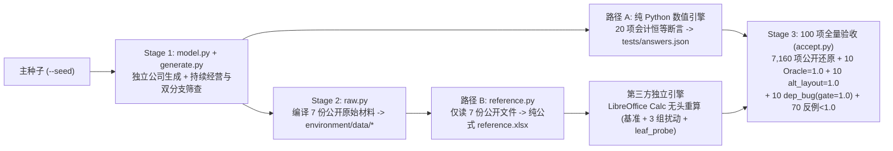

# DCFEval 评分标准演进（v1 → v3 从业者四支柱版）与参考解生产规范

本文档系统梳理 `DCFEval` 评测集的两大核心工程规范：
1. **DCF 从业者四支柱评分标准（[`dcf_benchmark/grade.py`](../dcf_benchmark/grade.py) v3.0 & [`accept.py`](../dcf_benchmark/accept.py)）**：从真实投行 / 买方估值审阅标准出发，彻底解决原版（v1）“静态硬编码反超动态模型”、v2.1 “39 格扰动盲区可被 `+0*B4` 伪公式绕过”以及“上游单点笔误触发三重连坐惩罚”等结构性缺陷。
2. **双独立路径参考解生产与校验闭环（[`model.py`](../dcf_benchmark/model.py) → [`raw.py`](../dcf_benchmark/raw.py) → [`reference.py`](../dcf_benchmark/reference.py) → [`audit_sources.py`](../dcf_benchmark/audit_sources.py) → [`build_all.py`](../dcf_benchmark/build_all.py)）**：零私有依赖、全参数化防同质化、双分支强制覆盖、纯公开材料构建参考解。

---

## 一、评分标准演进与 v3.0 从业者四支柱设计

### 1. 历史版本暴露的 4 类真实缺陷

| 缺陷编号 | 暴露现象 | 根因分析 | v3.0 解决方案 |
|---|---|---|---|
| **缺陷 1：贴死数反超真动态模型（v1）** | `dcf-04-storage`（**0/155 公式**、三组扰动全 0）旧分 **`0.6650`**，反超全动态公式、仅折旧漏括号的 `dcf-02-foundry`（`0.6252`） | v1 纯线性加权缺少动态门控 | 引入底层防贴死数 `dynamic_gate ∈ [0.20, 1.00]`，纯贴死数最高仅 `0.1520` |
| **缺陷 2：伪公式与 `+0*B4` 零乘数绕过（v1/v2.1）** | 39 个格子（经营驱动 `C4:G5`、债务利息、`DCF!B12:B15`）在 3 组扰动下不变；写 `=硬编码 + 0*Inputs!$B$4` 在 v2.1 可拿 **`1.0000`** | 静态正则只查“含引用+运算符”，未验证输入变化是否真引发重算 | 新增全工作簿静态叶节点微扰探针 **`leaf_probe`**，非零计算格必须真实响应输入微扰 |
| **缺陷 3：单点上游笔误触发三重连坐（v2.1）** | `dcf-02-foundry`（100% 动态公式、60/60 勾稽全过、仅折旧漏括号）在 v2.1 因绝对值扰动失分且连坐 `dynamic_gate=0.811`，被压至 `0.5101` | 扰动按绝对值判分且直接塞进 `dynamic_gate`，把“基准算错”误罚为“贴死数” | ① 扰动改判**变动增量 $\Delta$ 与比例弹性 $\%\Delta$**；② `dynamic_gate` 改用**非零响应率 `responsiveness_ratio`**，全动态模型 `gate` 恒为 `1.0000` |
| **缺陷 4：估值权重大锅饭与契约缺口（v1/v2.1）** | 核心估值结论 `DCF!B9`（每股价值）仅占 `1.4%`；`formulas` 抢占 `12%` 表面权重；旧题面 `license` 措辞、第 8 行豁免与 `B6` 单位未钉死 | 未按从业者关注度加权核心估值桥，且题面契约边界不完整 | ① 重构为 **40 / 25 / 15 / 20 从业者四支柱**（`B9` 提升至 `5%`，核心 `DCF!B4:B9` 占 `20%`）；② `formulas` 表面权重归 `0%` 仅作底层门控；③ 钉死三项题面契约 |

---

### 2. v3.0 四支柱评分权重明细（[`grade.py`](../dcf_benchmark/grade.py)）

主分 `raw_score` 满分 `100%`，精准对应 DCF 从业者审模型的四个核心维度：

| 支柱 | 总权重 | 评分维度 | 子权重 | 考核内容与容差 |
|---|---:|---|---:|---|
| **支柱一：三表与自由现金流预测** | **40%** | `history` | **7%** | FY2025 19 项历史科目（跨站千/元单位换算、过滤 `VOID`、合并长短债 `2112+2710`） |
| | | `forecast` | **21%** | FY2026–2030 130 项经营驱动、利润表、资产负债表、现金流量表（含第 8 行外生固定费用数值） |
| | | `fcff` | **12%** | FY2026–2030 20 项无杠杆税费、$\Delta\text{NWC}$、FCFF 与折现现值（连接三表与估值的咽喉） |
| **支柱二：估值桥与每股价值** | **25%** | `valuation` | **25%** | 差异化重要性加权：**核心估值桥 `DCF!B4:B9` 占 20%**（`B9` 每股稀释价值 **5.0%**、`B7` EV **3.5%**、`B8` 股权价值 **3.5%**、`B4` WACC **3.0%**、`B5` 终值 **2.5%**、`B6` 终值现值 **2.5%**）+ **资本与稀释表 `DCF!B12:B15` 占 5%**（Peer Beta 与 TSM 各 1.25%） |
| **支柱三：会计勾稽与表健康度** | **15%** | `ties` | **9%** | 基准 5 年 × 4 项会计恒等式（资产=负债+权益、现金流闭环、留存收益滚动、FCFF 恒等，共 20 项） |
| | | `ties_shock` | **4%** | **价格与回款天数扰动后的动态会计恒等式**（2 组扰动 × 5 年 × 4 项 = 40 项，且要求资产负债表科目 AR/Cash/Assets 发生真实变动，防止贴死表混分） |
| | | `controls` | **2%** | `Inputs!B4:B6` 可编辑假设（底层年化小数/天数）+ `Statements!B3:G3` 年份 `2025–2030` + 全表零 `#REF!/#DIV/0!/#VALUE!/#NAME?/#N/A` 报错 |
| **支柱四：假设敏感性增量联动** | **20%** | `shock_operations` | **7%** | 扰动单价乘数 `price_multiplier` 后的增量 $\Delta$ / 弹性 $\%\Delta$ 校验 |
| | | `shock_collection` | **6%** | 扰动回款天数 `dso_shift` 后的增量 $\Delta$ / 弹性 $\%\Delta$ 校验 |
| | | `shock_discount` | **7%** | 扰动无风险利率 `risk_free` 后的增量 $\Delta$ / 弹性 $\%\Delta$ 校验 |

#### 底层防贴死数门控（`formulas` 表面权重 = `0%`，只作门控）

1. **`formula_ratio`（155 个计算型单元格，豁免外生第 8 行）**：每格必须同时通过：
   - **静态递归计算链审计 `resolves_to_computation`**：必须含单元格引用，裸链接递归追踪至算术或函数运算（拦截纯数字、`=1.13` 常数公式、`=Helper!A1` 静态中转）；
   - **叶节点微扰探针 `leaf_probe`**：对工作簿内非年份/非索引/非科目码的静态数值叶节点施加 `1.7%–3.5%` 确定性微扰后由 LibreOffice 重算，所有基准非零（$|v| > 10^{-9}$）的计算格必须产生真实响应（$|v_{\text{probe}} - v_{\text{base}}| > \max(10^{-9}, 10^{-8}|v_{\text{base}}|)$），彻底封堵 `=常数 + 0*Inputs!$B$4` 死引用作弊。
2. **`responsiveness_ratio`（三组扰动非零响应率）**：统计三组扰动下所有理论应动格中满足 $|v_{\text{shock}} - v_{\text{base}}| > 10^{-9}$ 的比例——仅衡量“模型是不是活的”，与基准误差彻底解耦。
3. **最终得分公式**：
   $$\text{dynamic\_gate} = 0.20 + 0.80 \times \left(0.65 \cdot \text{formula\_ratio} + 0.35 \cdot \text{responsiveness\_ratio}\right)$$
   $$\text{reward} = \text{round}\left(\text{raw\_score} \times \text{dynamic\_gate},\ 9\right)$$

---

### 3. 10 题真实 DeepSeek 轨迹实测对比（v1 vs v2.1 vs **v3.0**）

将原始 10 题 DeepSeek 提交工作簿交由 `grade.py` v3.0 在 LibreOffice 中完整重算：

| 任务 | 三表&FCFF (40) | 估值桥 (25) | 勾稽 (15) | 敏感性Δ (20) | 有效公式 | 门控 Gate | v1 旧分 | v2.1 分 | **v3.0 新分** | 评估结论 |
|---|---:|---:|---:|---:|---:|---:|---:|---:|---:|---|
| `dcf-02-foundry` | 22.12 | 13.00 | 15.00 | 13.64 | 155/155 | **1.0000** | 0.6252 | 0.5101 | **0.6376** | 稳居第 1，消除多重连坐，真实体现高完成度动态模型 |
| `dcf-09-royalty` | 12.65 | 8.00 | 15.00 | 4.43 | 150/155 | 0.9498 | 0.4292 | 0.3069 | **0.3808** | 第 2，精准抓出 `DCF!B4, B12:B15` 静态中转别名 |
| `dcf-06-license` | 12.28 | 1.25 | 14.80 | 4.72 | 155/155 | 0.9709 | 0.3797 | 0.2823 | **0.3209** | 第 3，`#DIV/0!` 报错被 `controls` 精准扣分 |
| `dcf-03-orders` | 10.67 | 5.00 | 11.75 | 3.84 | 155/155 | 0.9984 | 0.3680 | 0.2687 | **0.3121** | 第 4，FCFF 漏折旧在基准与扰动勾稽中体现 |
| `dcf-10-returns` | 0.97 | 1.25 | 11.55 | 3.91 | 155/155 | 0.9871 | 0.1992 | 0.1679 | **0.1745** | 第 5，历史映射错位 + BS 不平 |
| `dcf-04-storage` | 37.00 | 25.00 | 11.00 | 0.00 | **0/155** | **0.2000** | ~~0.6650~~ | 0.1469 | **0.1460** | 降至第 6，彻底终结“贴死数反超动态模型” |
| `dcf-08-retail` | 11.04 | 8.00 | 11.00 | 0.00 | **0/155** | **0.2000** | ~~0.3423~~ | 0.0762 | **0.0601** | 降至第 7，纯硬编码 + 关店率算错 |
| `dcf-01 / 05 / 07` | 0.00 | 0.00 | 0.00 | 0.00 | 未交付 | 0.0000 | 0.0000 | 0.0000 | **0.0000** | 未生成工作簿 |
| **10 题均值** | — | — | — | — | — | — | 0.3009 | 0.1759 | **0.2032** | 排序与金融专业质量完全一致 |

---

## 二、参考解双独立路径生产与 100 项自动化验收

### 1. 四项核心流程重构
1. **100% 开源纯 Python 可复现**：移除所有 Node.js / 私有 Excel 包依赖，使用纯 Python `openpyxl`（[`reference.py`](../dcf_benchmark/reference.py)）生成动态公式工作簿。
2. **输入路径完全独立**：`reference.py` 在原始材料模式下**绝不读取私有 `canonical.json`**，只调用 `audit_sources.reconstruct()` 解析 `environment/data/` 的 7 份公开文件。
3. **全参数化防同质化 + 强制双分支触发**：每题独立采样公司规模、历史三表与完整资本/估值参数（WACC 分布 `6.61%–10.90%`、每股价值 `5.09–63.17 EUR`）；`branches_covered()` 强制 `foundry / storage / mine / royalty` 在五年内两侧 `MIN/MAX` 分支均触发；动态生成 3/5 家同行、动态流动/非流动债拆比、动态含价内+价外多批次期权。
4. **自包含 Docker 环境与标准开放评测接口**：每题 `Dockerfile` 内联自包含（优先阿里云镜像并自动回退官方源）+ `build_timeout_sec = 1200`；`pilot.py` 采用标准 OpenAI-compatible 环境变量接口。

### 2. 双独立路径校验闭环



**100 项全量验收指标（全部通过）**：
- `oracle`（10/10）：全部 **`1.0000`**，`pass_strict = true`；
- `alt_layout`（10/10，完全不同工作表布局、最小 `Inputs`、外生数值第 8 行、`IF` 等价公式、跨表链接）：全部 **`1.0000`**，证实零误杀；
- `single_dep_bug`（10/10，100% 动态公式 + 仅折旧漏括号）：`dynamic_gate = 1.0000`、`ties = 20/20`、`ties_shock = 40/40`、回款 $\Delta$ `100%`，得分 **`0.5883–0.6652`**；
- `frozen`（10/10，纯贴死数）：**`0.1520`**（`< 0.20`）；
- `terminal`（10/10，终值少折现一年）：**`0.8238–0.8264`**；
- `itm_filter`（10/10，错误纳入价外期权）：**`0.9250`**；
- `zero_mul_cheat`（10/10，`=val + 0*Inputs!$B$4` 死引用伪公式）：**`0.9530–0.9597`**（被 `leaf_probe` 拦截）；
- `fake_formula` & `alias_hardcode`（20/20）：**`0.9866`**；
- `missing`（10/10）：**`0.0000`**。

---

## 三、一键复现命令

```bash
# 1. 一键全自动无人工生成评测集（含 7,160 项公开还原审计）
python3 dcf_benchmark/build_all.py --seed 2026 --out DCFEval

# 2. 全量 100 项自动化验收（需 openpyxl 与 soffice）
python3 dcf_benchmark/accept.py DCFEval dcf_benchmark/results/acceptance.json

# 3. Harbor Oracle 端到端全量验证（10/10 全部 reward = 1.0）
harbor run -p DCFEval -a oracle -n 4 --jobs-dir "$PWD/dcf_benchmark/jobs" --job-name oracle-final

# 4. 正向 Python API 查验单题三表与估值真值
python3 dcf_benchmark/forward.py DCFEval/dcf-02-foundry/solution/canonical.json

# 5. 汇总 Harbor 评测任务分数表与逐题首项诊断
python3 dcf_benchmark/report.py dcf_benchmark/jobs/oracle-final
```
