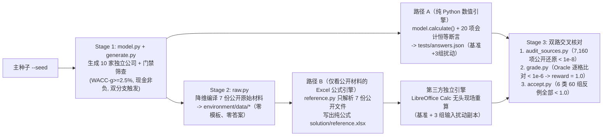

# DCFEval 评分标准修复与参考解生产流程规范

本文档系统梳理 `DCFEval` 评测集的两大核心升级：
1. **评分标准修复（[`dcf_benchmark/grade.py`](../dcf_benchmark/grade.py) & [`accept.py`](../dcf_benchmark/accept.py)）**：彻底解决原版评分中「纯硬编码静态表格反超真动态模型」「常数伪公式与静态中转别名绕过」「Excel 报错未显式记录」三大漏洞。
2. **参考解生产与独立校验流程重构（[`model.py`](../dcf_benchmark/model.py) → [`raw.py`](../dcf_benchmark/raw.py) → [`reference.py`](../dcf_benchmark/reference.py) → [`audit_sources.py`](../dcf_benchmark/audit_sources.py) → [`build_all.py`](../dcf_benchmark/build_all.py)）**：彻底消除私有依赖、消除 10 题参数同质化、消除参考解对私有真值的依赖，构建双独立路径可验证闭环。

---

## 一、原版评分标准的三大核心问题与修复方案

### 1. 问题诊断（基于 10 题实测暴露的真实缺陷）

| 缺陷编号 | 暴露现象 | 根因分析 | 危害 |
|---|---|---|---|
| **缺陷 1：动态模型权重失衡（最严重）** | `dcf-04-storage`（**0/160 条 Excel 公式**、三组扰动全 0、纯 Python 算完填死数字）拿到 **`0.6650`**，反而高于 **160/160 全动态公式**、20/20 勾稽全过、仅折旧公式漏一对括号的 `dcf-02-foundry`（`0.6252`） | 旧版纯线性加权中，静态数值+勾稽+控制项占 **69%**，公式（7%）+三组扰动（24%）仅占 **31%**，且无动态门控 | 诱导 Agent 用 Python 外部计算后硬编码填表，违背「从零构建可编辑动态 Excel DCF 模型」的核心评测目标 |
| **缺陷 2：伪公式与中转别名绕过** | 旧版 `grade.py` 仅判断 `cell.data_type == "f"`。对于不受三组扰动影响的 `DCF!B12:B15`（Beta、TSM 稀释股数），写 `=1.13` 常数公式或写 `=Helper!A1`（指向静态硬编码单元格）均可拿到满分 `1.0` | 缺少公式单元格引用校验与递归计算链追踪 | 存在可复现的评分作弊漏洞 |
| **缺陷 3：非金融标点噪声与错误诊断缺失** | `operations_memo.md` 中参数位于句尾且紧贴句号（如 `0.75198.`），导致部分模型正则解析异常崩溃；同时 `#DIV/0!` 等 Excel 公式错误未在 `details.json` 单独汇总 | 文本格式细节引入无关噪声；诊断字段缺少结构化公式错误列表与严格通过标记 | 混淆“正则解析小失误”与“真实财务建模能力”，不利于归因分析 |

---

### 2. 修复后的评分标准（`grade.py` v2）

#### (1) 递归公式计算链审计（`resolves_to_computation`）
对 160 个要求公式的输出单元格（`DCF!B4:B9, B12:B15` 与 `Statements!C4:G33`），不再只检查 `data_type == "f"`，而是递归审计公式 AST：
- **必须包含至少一个单元格引用**（彻底封堵 `=1.13`、`=0.4` 等常数字面量伪公式）；
- **若为单单元格裸引用（`=Sheet!A1`）**：自动沿引用链递归追踪上游单元格，确认最终落脚点是**真正的运算公式**（包含 `+ - * / ^` 或 Excel 函数如 `SUM / MEDIAN / AVERAGE / MIN / MAX / IF`），彻底封堵 `=Helper!A1` 静态中转作弊；
- **合理豁免**：仅对天然属于外生预算直引的 `Statements` 第 8 行（`Cash operating expense`）允许裸链接到输入数值格，同时允许任意合法的多工作表中间引用链（例如 `DCF!B15 = Capital!D16` 且 `Capital!D16 = SUM(D13:D15)`）。

#### (2) 权重重平衡 + 动态模型门控乘子（Dynamic Model Gate）
基础 10 项权重调整为（动态公式与三组扰动基础权重由 31% 提升至 **39%**）：

| 评分维度 | 旧权重 | 新权重 | 检查内容与容差 |
|---|---:|---:|---|
| `controls` | 3% | **3%** | `Inputs!B4:B6` 可编辑假设 + `Statements!B3:G3` 年份 `2025–2030` |
| `formulas` | 7% | **12%** | 160 个预测与估值单元格通过递归计算链审计 |
| `history` | 10% | **8%** | FY2025 19 项历史科目（跨站千/元单位换算、过滤 `VOID`、合并长短债） |
| `forecast` | 22% | **18%** | FY2026–2030 130 项利润表、资产负债表、现金流量表与经营量 |
| `fcff` | 10% | **9%** | 20 项无杠杆税费、ΔNWC、FCFF 与折现现值 |
| `valuation` | 14% | **14%** | 10 项核心估值与资本结构（WACC、TV、PV(TV)、EV、股权价值、每股价值、Beta、TSM） |
| `ties` | 10% | **9%** | 5 年 × 4 项会计恒等勾稽（资产负债表配平、现金流闭合、权益滚存、FCFF 定义） |
| `shock_operations` | 8% | **9%** | 扰动价格倍数 `price_multiplier` 后 LibreOffice 独立重算 |
| `shock_collection` | 8% | **9%** | 扰动回款天数 `dso_shift` 后 LibreOffice 独立重算 |
| `shock_discount` | 8% | **9%** | 扰动无风险利率 `risk_free` 后 LibreOffice 独立重算 |

在此基础上，引入连续可微、无断崖的**动态模型门控乘子**：

$$\text{formula\_ratio} = \frac{\text{formulas\_ok}}{\text{formulas\_total}}, \qquad \text{shock\_ratio} = \frac{\sum \text{shock\_ok}}{\sum \text{shock\_total}}$$

$$\text{dynamic\_gate} = 0.25 + 0.75 \times \left(0.6 \cdot \text{formula\_ratio} + 0.4 \cdot \text{shock\_ratio}\right)$$

$$\text{reward} = \text{raw\_score} \times \text{dynamic\_gate}$$

- **单调性与边界保障**：
  - **Oracle 与完全正确的活体模型**（`raw_score = 1.0`, `formula_ratio = 1.0`, `shock_ratio = 1.0`）：`dynamic_gate = 1.0` → **`reward = 1.0000`**，`pass_strict = true`；
  - **基准数 100% 正确但纯静态硬编码（`frozen`）**：`raw_score = 0.61`, `dynamic_gate = 0.25` → **`reward = 0.1525`**（旧版虚高至 `0.6900`）；
  - **160/160 全动态公式但局部公式小失误**：`dynamic_gate ≥ 0.70`，显著高于任何纯硬编码表格。
- **结构化诊断输出**：`details.json` 同步输出 `reward`、`pass_strict`（`reward == 1.0` 且零 Excel 错误）、`raw_score`、`dynamic_gate`、`formula_ratio`、`shock_ratio`、`excel_errors`（显式列出 `#REF! / #DIV/0! / #VALUE! / #NAME? / #N/A` 单元格）。

#### (3) 修复前后对真实 10 题实测分数的重算对照

基于先前 DeepSeek 10 题完整实测的逐维度原始通过计数，对比旧版与新版评分公式：

| 任务 | 动态公式比例 | 扰动通过率 | 旧版 Reward | 新版 Raw Score | 动态门控 Gate | **新版 Reward** | 排序合理性变化 |
|---|---:|---:|---:|---:|---:|---:|---|
| `dcf-02-foundry` | 100% (160/160) | 37% | 0.6252 | 0.6290 | 0.8110 | **0.5101** | **跃升第 1**（真动态模型，仅折旧漏括号） |
| `dcf-09-royalty` | 100% (160/160) | 0% | 0.4292 | 0.4385 | 0.7000 | **0.3069** | 第 2（有完整公式与勾稽，单价单位错） |
| `dcf-06-license` | 100% (160/160) | 7% | 0.3797 | 0.3917 | 0.7208 | **0.2823** | 第 3（有完整公式，稀释股数 `#DIV/0!`） |
| `dcf-03-orders` | 100% (160/160) | 0% | 0.3680 | 0.3839 | 0.7000 | **0.2687** | 第 4（有完整公式，单位与 WACC 错） |
| `dcf-10-returns` | 100% (160/160) | 0% | 0.1992 | 0.2398 | 0.7000 | **0.1679** | 第 5（有完整公式，历史行映射错） |
| `dcf-04-storage` | **0% (0/160)** | 0% | ~~0.6650~~ | 0.5875 | **0.2500** | **0.1469** | **从虚高第 1 降至第 6**（纯硬编码死数字） |
| `dcf-08-retail` | **0% (0/160)** | 0% | ~~0.3423~~ | 0.3046 | **0.2500** | **0.0762** | 降至第 7（纯硬编码 + 股价偏 41%） |
| `dcf-01 / 05 / 07` | 0%（未交付） | 0% | 0.0000 | 0.0000 | 0.0000 | **0.0000** | 未生成工作簿 |
| **10 题均值** | — | — | 0.3009 | — | — | **0.1759** | 彻底消除“静态硬编码反超动态模型”倒挂 |

---

## 二、参考解生产与独立校验流程重构

### 1. 原流程的 4 个隐蔽隐患与修复

| 隐患 | 原版实现问题 | 新版修复方案 |
|---|---|---|
| **私有工具依赖** | 原 Node 建表脚本依赖非公开第三方 Excel 包，外部评审机器无法运行造题复现命令 | 完全重写为纯 Python `openpyxl` 版 [`reference.py`](../dcf_benchmark/reference.py)，零 Node.js、零私有依赖 |
| **参考解未与私有真值彻底解耦** | 原 `reference.mjs` 仍从私有 `solution/canonical.json` 读取 `series` 和 `scalar` | 新版 `reference.py` 在原始材料模式下**仅调用 `audit_sources.reconstruct()` 读取 `environment/data/` 的 7 份公开文件**，不读取任何私有 `canonical.json` 字段 |
| **跨题财务参数雷同 + 分支未触发** | 原 `model.py` / `raw.py` 10 题共用同一组 WACC（`7.99%`）、同一份历史资产负债表和写死的 TSM 增量 `0.4M`，且 `02-foundry` 5 年从未触发产能瓶颈 | 按每题独立种子全参数采样公司规模、历史三表、$R_f/\beta/\text{ERP}/W_d/K_d/\tau/g/M$、动态 3/5 家可比公司、动态流动/非流动债拆比、动态含价内+价外多批次期权；加入 `branches_covered()` 强制 4 类非线性题双分支均触发 |
| **容器构建依赖外部前置镜像** | 原 `Dockerfile` 依赖本地手动 `docker build -t dcfeval-calc:v1` | 每题 `Dockerfile` 内联自包含（优先阿里云镜像并自动回退官方源）+ 10 题共享前段 Docker Layer Cache + `build_timeout_sec = 1200` |

---

### 2. 双独立路径的参考解生产闭环（如何 mathematically 证明参考值 100% 正确）



**四重独立证明链**：
1. **会计恒等式硬断言**：`model.py` 与 `grade.py` 独立校验全部 5 年资产负债表配平（$|\text{Assets} - (\text{Liab}+\text{Equity})| < 10^{-8}$）、现金流期末现金闭合、留存收益权益滚存、FCFF 定义恒等。
2. **输入路径独立**：`reference.py` 在生产 `reference.xlsx` 时**不读 `canonical.json`**，只从 `environment/data/` 下的 7 份公开原始文件重建输入——如果公开材料缺少任何信息或单位笔误，参考解本身就会构建失败或偏离 `answers.json`。
3. **计算引擎独立**：`answers.json` 由纯 Python 浮点引擎算出；`reference.xlsx` 只写 Excel 公式字符串，交由独立第三方电子表格引擎 **LibreOffice Calc** 重算，两者在基准与 3 组扰动下超过 500 个单元格/题、误差全部 $< 10^{-6}$。
4. **6 类 60 组反例突变验收（[`accept.py`](../dcf_benchmark/accept.py)）**：
   - `frozen`（纯静态数值冻结）：要求 `reward < 0.25`（实测 `0.1525`）且三组扰动全 0；
   - `fake_formula`（无单元格引用常数伪公式 `=1.13`）：要求 `formulas` 扣分且 `reward < 1.0`；
   - `alias_hardcode`（裸链接指向辅助表硬编码 `=Helper!A1`）：要求 `formulas` 扣分且 `reward < 1.0`；
   - `terminal`（终值少折现一年）：要求 `valuation` 扣分且 `reward < 1.0`；
   - `itm_filter`（错误纳入价外期权）：要求 `DCF!B9` 每股价值报错且 `reward < 1.0`；
   - `missing`（未交付工作簿）：`reward == 0.0`。

---

## 三、一键复现与扩展命令清单

```bash
# 1. 一键全自动无人工生成全新 Seed 评测集（含 7 份原始材料 + 独立参考解 + 7,160 项公开还原审计）
python3 dcf_benchmark/build_all.py --seed 2026 --out DCFEval

# 2. 本地全量 Oracle + 6 类 60 组反例突变验收（需 openpyxl 与 soffice）
python3 dcf_benchmark/accept.py DCFEval dcf_benchmark/results/acceptance.json

# 3. Harbor Oracle 全量端到端验证（10/10 必须全部 reward = 1.0）
harbor run -p DCFEval -a oracle -n 4 --jobs-dir dcf_benchmark/jobs --job-name oracle-final

# 4. 直接用正向 Python API 查验单题完整三表与估值真值
python3 dcf_benchmark/forward.py DCFEval/dcf-02-foundry/solution/canonical.json

# 5. 汇总任意 Harbor 评测任务分数表与逐题失败诊断
python3 dcf_benchmark/report.py dcf_benchmark/jobs/oracle-final
```
